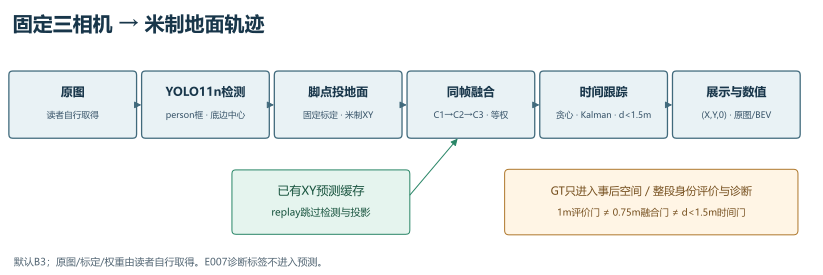
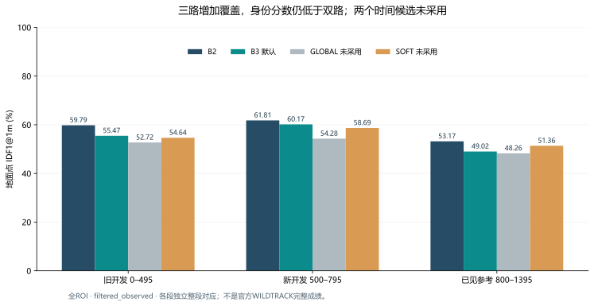

# 多相机行人地面定位与跟踪

固定标定相机上的离线研究demo：用预训练YOLO11n检测行人，将框底中心投到地面，按相机顺序融合，再按真实时间步维护轨迹。输出米制 **(X,Y,0)**，不估计人体高度或完整三维框。

默认 **B3=C1+C2+C3等权融合＋原贪心时间关联**。本仓库保留E001–E007源码、用户原有中文学习注释、正负实验摘要及小型数值参考；E003加权、E005全局分配、E006有限未匹配代价均未采用。E007是诊断，没有新的算法提升结果。

## 主要结果

同一旧开发片段0–495、100个时刻、全ROI全部GT分母2152，observed空间匹配从单相机875增加到双相机1468、三相机1774；同时未匹配预测从168增加到411、869。覆盖增加伴随额外输出与身份代价。

| 地面点IDF1@1m，observed，全ROI | B2 | 默认B3 | E005 GLOBAL | E006 SOFT |
|---|---:|---:|---:|---:|
| 旧开发0–495 | 59.79% | 55.47% | 52.72% | 54.64% |
| 新开发500–795 | 61.81% | 60.17% | 54.28% | 58.69% |
| 已见参考800–1395 | 53.17% | 49.02% | 48.26% | 51.36% |

B3三段IDTP比B2净增125/105/47，但新增与损失并存，预测总数也增加。E007进一步拆为新增354/207/356、损失229/102/309个IDTP人时刻；有限图证支持门内异人组合、正常覆盖和未确认情况共存，不能外推总体错误归因率。详见[完整结果](docs/RESULTS.md)和[数值表](results/summary/README.md)。

这些是项目自定义片段与地面点协议，**不是官方完整WILDTRACK成绩**。800–1395已在研究中使用，称“已见参考”；1400–1995未启用。局部改善不代替预登记的整段门槛。

## 运行与阅读

- **只看成果**：本页、[实验索引](experiments/README.md)、[评价协议](docs/EVALUATION.md)，不需要数据或GPU环境。
- **从原图生成demo**：自行取得WILDTRACK/标定和YOLO11n权重，按[快速开始](docs/QUICKSTART.md)运行`images`到新目录；不依赖旧实验outputs。
- **缓存复现**：使用仓库内[三路预测CSV及轨迹](results/b3_reference/README.md)运行`replay`；省去检测，但渲染仍需原图/标定。四个CSV不是七轮实验的完整缓存。
- **读代码**：[代码阅读路线](docs/CODE_READING.md)按文件、函数和关键片段定位；[目录导航](ARCHITECTURE.md)与[系统数据流](docs/ARCHITECTURE.md)说明职责边界。

本次整理在既有Windows/Python3.12.6环境中运行46项不需数据的CPU测试，并完成一次120时刻缓存回放，4956条参考状态所有字段一致；另2项标定测试本轮未运行。没有重新GPU检测、安装、下载或训练。安装说明保留固定Windows/CUDA依赖事实，不宣称全新安装或跨平台已验证。

## 限制与来源

框底是脚点近似；遮挡、截断、同帧误融合、重复组和时间错误继承仍存在。三路并不保证身份更准，ID数不是人数，短窗口的视觉判断也不等同全段身份真值。见[限制与失败](docs/LIMITATIONS.md)。

源码采用[AGPL-3.0](LICENSE)，署名yly-ljl。第三方库、模型与数据各有自己的许可条件，见[第三方声明](THIRD_PARTY_NOTICES.md)。数据/权重/环境、原图截图、两份本地视频与48窗图证不包含在仓库中；自绘图和数值表可以直接阅读。

使用数据请引用 *WILDTRACK: A Multi-Camera HD Dataset for Dense Unscripted Pedestrian Detection*（Chavdarova等，CVPR 2018），来源和获取入口见[数据与模型](docs/DATA_AND_MODELS.md)。本仓库首次整理版为v0.3-demo，表示发布整理，不表示性能提升；[版本说明](docs/VERSION.md)与[来源映射](docs/PROVENANCE.md)区分研究原件和新发布历史。
